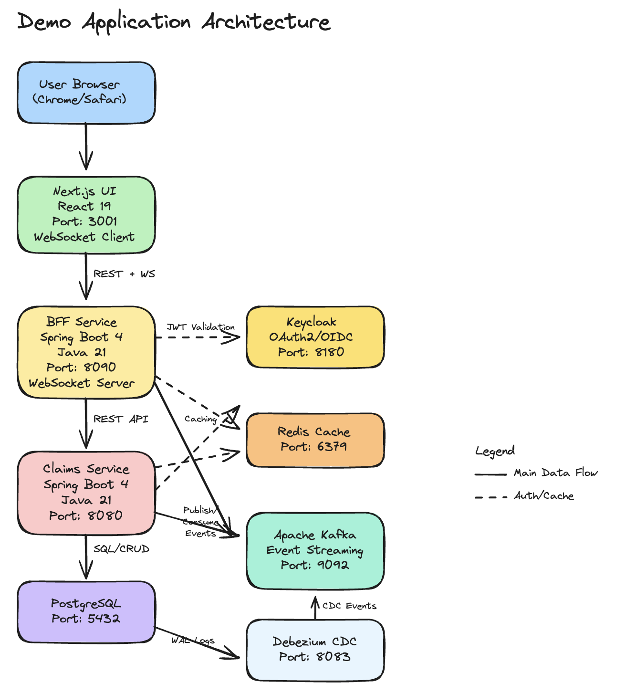

# Demo Application Architecture

## System Overview

A full-stack microservices application demonstrating modern cloud-native patterns: OAuth2 authentication, event-driven architecture via Kafka and CDC, real-time WebSocket updates, and a Backend-for-Frontend (BFF) API gateway.

---

## Architecture Diagram



Editable source: [architecture-diagram.excalidraw](architecture-diagram.excalidraw).

### Text Diagram

```
Browser ── HTTP ──> Next.js UI (:3001) ── REST ──> BFF (:8090)
  ▲                                                │  │
  │ WebSocket updates                              │  ├── OIDC/JWKS ──> Keycloak (:8180)
  │                                                │  ├── REST/JWT ───> Claims Service (:8080)
  │                                                │  └── Cache ──────> Redis (:6379)
  │                                                │
  └──────────────────── BFF WebSocket hub <── Kafka (:9092) <── Claims Service
                                                       ▲
PostgreSQL (:5432) ── WAL ──> Debezium (:8083) ────────┘
                               (optional CDC mode)
```

PostgreSQL is the Claims Service's system of record. Redis is used by the
backend services for caching. In the default event mode, the Claims Service
publishes events directly to Kafka; Debezium CDC is an optional alternative
described in the root README, not a component that must run alongside direct
publishing.

---

## Component Details

### Frontend — Next.js UI (Port 3001)
- **Framework:** Next.js 16, React 19
- **State:** Zustand
- **API:** Auto-generated TypeScript client from OpenAPI spec
- **Real-time:** WebSocket connection to BFF for live updates
- **Auth:** Login and refresh requests go through the BFF; access and refresh tokens are set as HTTP-only cookies.

### BFF Service (Port 8090)
- **Purpose:** API gateway and aggregation layer for the UI
- **Technology:** Spring Boot 4, Java 21
- **Responsibilities:**
  - Validates JWTs using Keycloak signing keys and maps Keycloak realm roles to application roles
  - Proxies and aggregates calls to Claims Service
  - Forwards user or service-account credentials to Claims Service, depending on the operation
  - WebSocket hub — pushes real-time events to connected browsers
  - Session/token caching via Redis
  - Publishes and consumes Kafka events

### Claims Service (Port 8080)
- **Purpose:** Core business logic — claims management
- **Technology:** Spring Boot 4, Java 21
- **Responsibilities:**
  - Claims CRUD (PostgreSQL via JPA + Liquibase migrations)
  - User management
  - Dashboard data aggregation
  - Redis caching
  - Kafka event publishing and consumption

---

## Infrastructure

| Component | Port | Purpose |
|-----------|------|---------|
| Keycloak | 8180 | OAuth2/OIDC identity provider. Realm: `demo-app`. Runs dev-mem (H2) — no volume needed. |
| PostgreSQL | 5432 | Primary relational database |
| Redis | 6379 | Distributed cache and session store |
| Apache Kafka | 9092 | Event streaming backbone |
| Zookeeper | 2181 | Kafka cluster coordination |
| Debezium | 8083 | Change Data Capture — monitors PostgreSQL WAL, publishes changes to Kafka |
| Kafka UI | 9093 | Browser UI to browse topics and messages |

---

## Data Flow Patterns

### 1. User Request
```
Browser → Next.js UI → BFF → Claims Service → PostgreSQL
                         ↓
                      Keycloak (JWT validation)
```

### 2. Claim status updates

```
Admin UI → BFF → Claims Service → PostgreSQL
```

### 3. Real-time updates

```
Claims Service publishes to Kafka (default) → BFF consumes → WebSocket → UI
```

Debezium can publish PostgreSQL WAL changes to Kafka in the optional CDC mode.
The root README explains how to select that mode; direct publishing and CDC
should not run together because that would duplicate notifications.
```

---

## Technology Stack

| Component | Technology | Version |
|-----------|-----------|---------|
| Frontend | Next.js + React | 16.1.6 / 19.2.3 |
| Backend | Spring Boot | 4.0.2 |
| Runtime | Java | 21 |
| Database | PostgreSQL | 15 |
| Cache | Redis | 7 |
| Auth | Keycloak | 26.5.2 |
| Message Broker | Apache Kafka | 7.5.0 (Confluent) |
| CDC | Debezium | 2.4 |

---

## Architecture Patterns

- **Hexagonal (Ports & Adapters):** Both backend services use strict layer separation — domain, application, and adapter layers
- **Backend for Frontend (BFF):** Dedicated API gateway tailored to the UI's needs
- **API-First:** OpenAPI specs are the source of truth; Java DTOs and TypeScript clients are generated from them
- **Event-Driven:** Services communicate asynchronously via Kafka; direct publishing is the default and Debezium CDC is optional
- **OAuth2 / OIDC:** Business APIs require authentication; admin endpoints require the `ADMIN` role. Login and refresh are handled by the BFF with Keycloak.

---

## Security Notes

- **Keycloak** runs in `start-dev` mode with an in-memory H2 database. The realm (`demo-app`) is auto-imported from `docker/compose/keycloak/`. Realm config is not persisted to a volume — the JSON file is the source of truth.
- **JWT validation:** Backend services fetch signing keys from Keycloak's internal Docker hostname (`keycloak:8080`). The `iss` claim in tokens is stamped with the browser-facing URL (`localhost:8180`) via `KC_HOSTNAME` configuration.
- **No production hardening** — this is a demo/QA environment. Credentials are intentionally simple.
