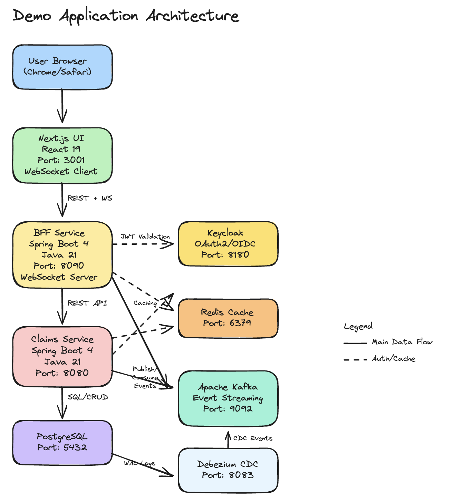

# Demo App — Insurance Claims Management

A three-tier microservices application used as a QA assessment platform. Backend services include unit tests; this assessment adds Playwright UI and API coverage.

---

## Architecture



| Tier | Technology | Port |
|------|-----------|------|
| UI | Next.js 16 + React 19 | 3001 |
| BFF | Spring Boot 4 + Java 21 | 8090 |
| Claims Service | Spring Boot 4 + Java 21 | 8080 |
| Auth | Keycloak 26 (OAuth2/OIDC) | 8180 |
| Database | PostgreSQL 15 | 5432 |
| Cache | Redis 7 | 6379 |
| Event Streaming | Apache Kafka | 9092 |
| Kafka UI | provectuslabs/kafka-ui | 9093 |
| CDC (optional) | Debezium 2.4 | 8083 |

See [ARCHITECTURE.md](ARCHITECTURE.md) for full details.

---

## Prerequisites

| Tool | Min version | Check | Install |
|------|-------------|-------|---------|
| **Docker Desktop** | 24+ | `docker --version` | https://docs.docker.com/get-docker/ |
| **Java (JDK)** | 21 | `java -version` | https://adoptium.net |
| **Maven** | 3.9+ | `mvn -version` | https://maven.apache.org/download.cgi |
| **Node.js** | 20+ | `node --version` | https://nodejs.org |

> **macOS:** `brew install --cask docker && brew install temurin@21 maven node`

---

## Quick Start

```bash
./start-infra.sh   # Start PostgreSQL, Kafka, Redis, Keycloak
./start-app.sh     # Build JARs + start Claims Service, BFF, UI
```

> First run: ~2–3 min (image downloads). Subsequent starts: ~30 seconds.

### URLs

| What | URL | Credentials |
|------|-----|-------------|
| **Demo App UI** | http://localhost:3001 | See test users below |
| BFF Swagger | http://localhost:8090/swagger-ui.html | — |
| Claims Swagger | http://localhost:8080/swagger-ui.html | — |
| Keycloak Admin | http://localhost:8180 | `admin` / `Admin123!` |
| Kafka UI | http://localhost:9093 | — |

### Test Users

| Role | Username | Password |
|------|----------|----------|
| Admin | `admin@demo.com` | `Admin123!` |
| Claimant | `claimant@demo.com` | `Claimant123!` |

---

## Stop

```bash
./stop-app.sh
./stop-infra.sh

# Wipe all data for a clean slate:
./stop-app.sh && ./stop-infra.sh -v
```

---

## Real-Time Events — Two Modes

Claim events are pushed to the UI in real time via WebSocket. There are two ways to generate those events — choose one. Running both simultaneously causes duplicate notifications.

### Mode 1: Direct Kafka (default)

The Claims Service publishes events directly to Kafka after each write. No extra setup needed.

`APP_EVENTS_CDC_ENABLED=false` is set by default in `docker-compose.apps.yml`. Just run the normal startup above.

---

### Mode 2: Change Data Capture via Debezium

Debezium monitors the PostgreSQL WAL (write-ahead log) and publishes database changes to Kafka. The BFF consumes these CDC events.

**Step 1** — In `docker-compose.apps.yml`, set:
```yaml
APP_EVENTS_CDC_ENABLED: "true"
```

**Step 2** — Start the app (infra + app must be running first):
```bash
./start-app.sh
```

**Step 3** — Start Debezium after the app is healthy:
```bash
./start-cdc.sh
```

**Verify connector is running:**
```bash
curl http://localhost:8083/connectors/claims-connector/status | python3 -m json.tool
```
You should see `"state": "RUNNING"` for both the connector and its task.

**Stop CDC:**
```bash
./stop-cdc.sh
```

> To switch back to direct Kafka: set `APP_EVENTS_CDC_ENABLED=false` and run `./start-app.sh`.

---

## Testing

### What's already there

The backend services ship with **unit tests**; this assessment adds Playwright UI and API coverage. The project also contains scaffolding for additional testing types.

| Layer | Framework | Status |
|-------|-----------|--------|
| Backend unit tests | JUnit 5, Mockito, AssertJ | Provided — some may need fixing |
| E2E UI tests | Playwright | JavaScript POM suite |
| API tests | Playwright APIRequestContext | JavaScript suite using the BFF OpenAPI contract |
| Contract tests | Pact | Scaffolded — empty |
| Integration tests | Testcontainers | Scaffolded — empty |
| Architecture tests | ArchUnit | Provided |

### What's been disabled

To keep the build simple and focused on the app itself, the following have been turned off in `pom.xml` (but the code/config remains for the QA team to re-enable and work with):

| Feature | Property | Notes |
|---------|----------|-------|
| WireMock stub generation | `skipWiremockGeneration=true` | Stubs exist in `code/bff-service/mocks/` |
| AsyncAPI doc generation | `skipAsyncApiGeneration=true` | Specs exist in `src/main/resources/asyncapi/` |
| Postman collection generation | `skipPostmanGeneration=true` | Can be re-enabled |
| Kafka schema validation | `kafka.producer.schema-validation.enabled=false` | Schema files exist in `asyncapi/schemas/` |
| Checkstyle / PMD | Skipped in Docker build | Still runs locally via `mvn verify` |

### QA team scope

The app is a blank canvas for testing. Suggested areas:

- Fix and extend backend unit tests (a broken test exists as a starting point)
- Add integration tests using Testcontainers
- Build out Pact contract tests between BFF and Claims Service
- Write Playwright E2E tests for the main user journeys
- Add load/performance tests (K6, Gatling, etc.)
- Create a test strategy document
- Write manual test scripts

### Run backend unit tests

```bash
# Backend
cd code/claims-service && mvn test
cd code/bff-service && mvn test

```

### Run Playwright tests (requires full stack running)

Install the root test dependencies once:

```bash
npm install
```

Before running Playwright tests, configure the seeded account emails and
passwords in the environment variables
`PLAYWRIGHT_CLAIMANT_EMAIL`, `PLAYWRIGHT_CLAIMANT_PASSWORD`,
`PLAYWRIGHT_ADMIN_EMAIL`, and `PLAYWRIGHT_ADMIN_PASSWORD`. Keep the values out
of source files and commits.

From the repository root, list or run the tests:

```bash
npm run test:e2e -- --list
npm run test:ui
npm run test:api
npm run test:e2e
```

Playwright writes its HTML/JUnit report to root `playwright-report/` and test
artifacts to root `test-results/`.
The generated Claimant and Admin browser states are stored under the ignored
root `playwright/.auth/` directory.
The latest UI execution's screenshots and videos are also copied into the
root `Screenshots/` and `Videos/` folders for assessment review; original
per-test artifacts remain in `test-results/`. Screenshot and video recording
are enabled in `playwright.config.js`.

### Latest assessment execution results (2026-11-24)

| Suite | Tests | Passed | Failed | Skipped | Result |
|---|---:|---:|---:|---:|---|
| UI | 9 | 9 | 0 | 0 | 7 Claims workflows and 2 auth setup checks passed |
| API | 8 | 6 | 2 | 0 | Two reproduced API contract defects |

The UI run's actual media is in `Screenshots/` (9 PNG files) and `Videos/` (7
WebM files). The API run's two failures are documented as DEF-API-001 and
DEF-API-002 in `assessment/DEFECT-REPORT.md`; the JUnit report records one
assertion failure and one schema-validation error.

The assessment-provided Test Case and Defect templates were not present in the
workspace. `assessment/TEST-CASES.md` and `assessment/DEFECT-REPORT.md` use
self-created replacement templates based on the checklist requirements; they
are not presented as supplied originals. Exact compliance with the missing
templates cannot be verified.

Run these commands from the repository root. The shared configuration is
`playwright.config.js`; UI application source and its dev server remain in
`code/demo-app-ui`.

---

## Diagnostics

```bash
# Container status
docker compose -f docker-compose.infra.yml ps
docker compose -f docker-compose.apps.yml ps

# Service logs
docker compose -f docker-compose.apps.yml logs -f claims-service
docker compose -f docker-compose.apps.yml logs -f bff-service
docker compose -f docker-compose.apps.yml logs -f ui

# Health checks
curl http://localhost:8080/actuator/health   # Claims Service
curl http://localhost:8090/actuator/health   # BFF Service
```

---

## Running Services Locally (IDE / Debugging)

Start infra via Docker, then run services on your machine:

```bash
./start-infra.sh

# Terminal 1
cd code/claims-service && mvn spring-boot:run

# Terminal 2
cd code/bff-service && mvn spring-boot:run

# Terminal 3
cd code/demo-app-ui
npm install   # first time only
npm run dev -- --port 3001
```

---

## Rebuilding After Code Changes

```bash
# Full rebuild (Maven + Docker)
./start-app.sh

# Rebuild a single service image only
docker compose -f docker-compose.apps.yml up --build --pull never claims-service
docker compose -f docker-compose.apps.yml up --build --pull never bff-service
docker compose -f docker-compose.apps.yml up --build --pull never ui
```

## Assessment Submission

- AI Journal: `assessment/AI-JOURNAL.md`
- Architecture Diagram and document: `architecture-diagram.excalidraw` and `ARCHITECTURE.md`
- Test Strategy: `assessment/TEST-STRATEGY.md`
- Test Cases: `assessment/TEST-CASES.md`
- Playwright UI Tests: `tests/e2e`
- API Tests: `tests/api`
- Defect Report: `assessment/DEFECT-REPORT.md`
